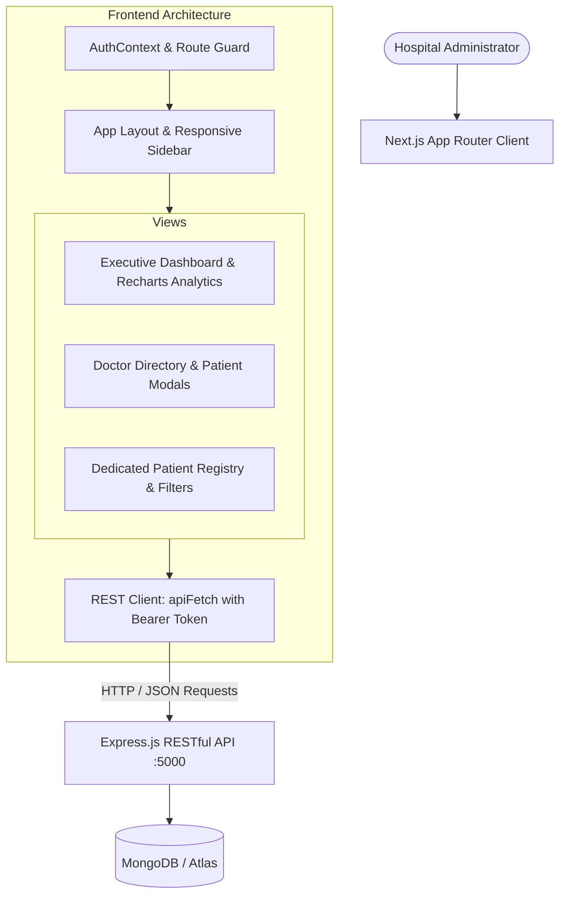

# Doctor Tracker - Frontend Client Application

## Description
Doctor Tracker is a modern, high-performance administrative web application built with Next.js and custom medical design system tokens that enables hospital administrators to seamlessly oversee medical staff, track patient caseloads, and analyze clinical trends. Designed for responsiveness and visual clarity, the portal features real-time search, compound filtering, pagination, and data visualizations across clinical departments.

---

## Setup Guide

### Prerequisites
- Node.js (v18.x or v20.x+)
- npm or yarn
- Running Doctor Tracker Backend server (default: `http://localhost:5000`)

### Step-by-Step Installation

1. **Navigate to the frontend directory:**
   ```bash
   cd frontend
   ```

2. **Install dependencies:**
   ```bash
   npm install
   ```

3. **Configure Environment Variables:**
   Create `.env.local` using `.env.example`:
   ```bash
   cp .env.example .env.local
   ```

   **`.env.example` contents:**
   ```env
   NEXT_PUBLIC_API_URL=http://localhost:5000/api
   ```

4. **Run the Development Server:**
   ```bash
   npm run dev
   ```
   The client application will start at: `http://localhost:3000`

5. **Authenticate with Default Admin Account:**
   - **Email:** `admin@doctortracker.com`
   - **Password:** `admin123`
   *(Or click the one-click "Fill Demo Credentials" button on the login screen!)*

6. **Build for Production (Optional):**
   ```bash
   npm run build
   npm start
   ```

---

## System Architecture



### Data Flow & State Management
1. **Route Protection & Session Persistence:** `AuthContext` initializes upon client load, checking `localStorage` for active JWT tokens and validating the user profile against `/api/auth/me`. Unauthorized requests automatically redirect to `/login`.
2. **Debounced Query Execution:** All search inputs in Doctor and Patient views leverage debounced state triggers (300ms) to prevent unnecessary query thrashing and minimize backend server load.
3. **Optimized Data Fetching:** Frontend interacts directly with RESTful endpoints (`/api/doctors`, `/api/patients`, `/api/dashboard/stats`), receiving pre-aggregated data and compound pagination metadata.

---

## Technical Decisions

### Decision 1: Context API with Centralized REST Interceptor vs. External State Stores (Redux / Zustand)
- **Context:** The application requires global management of user authentication, active sessions, and route guards, while individual tables maintain localized search, filter, and pagination states.
- **Rationale:** Introducing Redux Toolkit or external store boilerplate for an administrative dashboard creates unnecessary complexity and increases bundle size. 
- **Implementation:** We implemented a lightweight `AuthContext` coupled with a centralized `apiFetch` utility that injects `Authorization: Bearer <token>` headers into every request and seamlessly intercepts `401 Unauthorized` responses to clear invalid sessions. Localized component state manages table filters and debounced inputs, maximizing rendering efficiency.

### Decision 2: Pure SVG-Driven Recharts with Responsive Containers for Clinical Visualization
- **Context:** Section 3 requires visual representation of total doctors, total patients, patient-to-doctor ratios, and date-based admissions trends.
- **Rationale:** Traditional canvas-based chart libraries (e.g. Chart.js) often introduce hydration discrepancies and blurriness on Retina displays.
- **Implementation:** We integrated `recharts`, which renders pure declarative SVG elements wrapped in dynamic `ResponsiveContainer` components. This allows gradient fills, smooth SVG transitions, and custom tooltips without causing layout shift or hydration warnings in Next.js.

---

## Visual Evidence & UI Overview

### 1. Authentication Portal (`/login`)
- Sleek glassmorphic card on deep navy obsidian background (`#0A0F1D`).
- Email and password input fields with toggle password visibility.
- One-click **"Fill Demo Credentials"** button for immediate evaluation.

### 2. Clinical Operations Dashboard (`/`)
- Four primary stat cards: Total Doctors, Total Patients, Average Patients/Doctor, and Critical Cases.
- **Patients per Doctor Distribution:** Horizontal/vertical gradient bar chart reflecting staff caseload.
- **Date-Based Admissions Trend:** Area chart displaying 7-day intake frequency with smooth curves.
- **Patient Condition Distribution:** Donut chart categorizing Critical, Serious, Stable, Chronic, and Recovering patients.
- **Department Breakdown & Recent Admissions:** Progress bars for specialties and quick-action table.

### 3. Doctors Management (`/doctors`)
- Instant search bar (name, email, specialization, hospital).
- Specialization dropdown filter & hospital dropdown filter.
- Date-wise registration filter (from date & to date).
- Interactive table showing active patient count badges.
- **Actions:**
  - View corresponding patients list modal with ability to delete patients directly from the doctor's roster.
  - "Add Patient" modal to admit patients directly under a selected doctor.
  - Create and edit doctor profiles with complete validation.

### 4. Dedicated Patients Management (`/patients`)
- Comprehensive patient directory with condition badges (Critical: Rose, Serious: Amber, Stable: Emerald, Chronic: Violet, Recovering: Cyan).
- Filter by Condition, Filter by Assigned Doctor, and Filter by Admission Date Range.
- Full CRUD: Create, Edit patient details, and Delete with instant UI update.
- Pagination controls with custom rows-per-page selector.

---

## Git Repository
- Frontend Repository: `https://github.com/Mehedii-07/Doctor-Tracker-Forntend-.git`
- Backend Repository: `https://github.com/Mehedii-07/Doctor-Tracker-Backend.git`
- Admin Demo Credentials: `admin@doctortracker.com` / `admin123`
